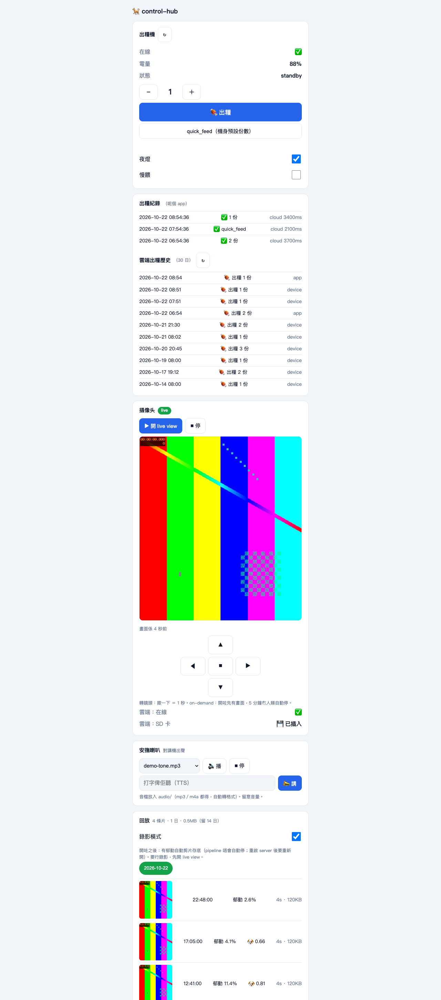
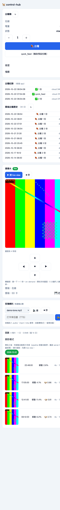

# philips-cam-control-hub

**One self-hosted dashboard for a Wi-Fi pet camera + smart feeder — built on a fully reverse-engineered protocol stack, in pure Python.**

No vendor cloud in the live path. No Android emulator. No patched firmware.
A FastAPI hub runs live view, pan/tilt, talk-back audio, motion recording with
on-device dog detection, feeder control, and a replay browser — all on one page.

The vendor stack gives you a phone app and a cloud subscription. This project
answers: *what if the camera were just... mine?*

## Why

Off the shelf, this camera + feeder can't do any of the things I actually wanted:

| The vendor gives | This repo adds |
|---|---|
| Phone-app-only control | One-page web dashboard (LAN + Tailscale, phone-friendly) |
| History clips behind a cloud plan | Local motion clips, dog-gated, 14-day retention |
| One-way listening (you watch) | Talk-back speaker (audio files + TTS from the browser) |
| Notify on *any* pixel change | Telegram alerts only when the dog is confirmed in frame |
| Nothing programmable | A whitelisted feeder API with hard safety guards |

So I reverse-engineered the entire stack — the ThroughTek P2P camera protocol,
the vendor cloud API, and the Tuya feeder — and rebuilt it as one local hub.

## Demo

The dashboard (UI is in Cantonese — it's my home dashboard, it stays honest):





*Camera frame and clips in these shots are a synthetic test pattern — the real
feed stays private. Generate the same thing with no hardware:
`python3 demo/demo_server.py`.*

## Architecture

```
browser ──HTTP──▶ hub.py (FastAPI, :8790)
                   │
                   ├─▶ dispatcher ──command whitelist──▶ Tuya (cloud, LAN fallback) ──▶ feeder
                   │
                   ├─▶ PipelineManager (state machine, orphan recovery, idle auto-stop)
                   │      └─ owns one subprocess group:
                   │           dog_final.py ── pure-Python PPCS P2P client ──UDP──▶ camera
                   │             ├─ writes NAL-filtered H.264 dump + motion % + audio RMS
                   │             └─ relays PTZ / talk-back commands from the hub
                   │           renderer.py ── dump tail ──ffmpeg──▶ live_latest.jpg (~5s cycle)
                   │
                   ├─▶ motion_recorder ── 2-poll confirm ──▶ dog gate (Apple Vision,
                   │      fully on-device) ──▶ clip cutter (30s pre-roll, h264 copy)
                   │
                   └─▶ Telegram alerts (only when the dog is confirmed in frame)
```

Component map:

| File | Role |
|---|---|
| `src/hub.py` | FastAPI app; one seam (`create_app(...)`) so tests inject fakes |
| `src/pyp2p_cam.py` | The decoded protocol: single-file pure-Python P2P camera client |
| `src/dog_final.py` | The live session: video dump, motion/audio analysis, command relays |
| `src/renderer.py` | Dump tail → decode → `live_latest.jpg` on a ~5s cycle |
| `src/pipeline.py` | Process-group lifecycle, orphan recovery, timeouts, auto-restart |
| `src/motion_recorder.py` | Motion → gate → clip files (mp4 + jpg + json per event) |
| `src/dog_gate.py` | Apple Vision animal classifier, on-device (macOS) |
| `src/dispatcher.py` | The only webapp→device path; whitelist + hard-deny + busy lock |
| `src/feeder.py` / `src/feeder_lan.py` | Tuya cloud feeder + LAN-direct fallback with dp map |
| `src/cam_backup.py` | RE'd vendor cloud API client (status, month flags) |
| `src/gopcap.py` | Boundary-preserving packet capture — the protocol research tool |

## Highlights

- **The P2P protocol, decoded and implemented in Python.** The camera speaks a
  ThroughTek-derived P2P protocol (f1 frame family over UDP via relays). Login,
  stream negotiation, data channels, PTZ and talk-back all re-implemented from
  packet captures — no vendor SDK, no `.so` loading.
- **The bug that explained a year of "corruption": ACK channel mismatch.** Video
  packets ride data channel `d1 02`, but the acks went to the vendor channel
  `d1 00`. The camera never saw them and retransmitted every packet ~19×,
  flooding the stream — which looked exactly like "GOP head perfect, then
  progressive mush". An A/B measurement (121 distinct packets acked vs 1337/1337)
  pinned it; the fix is two lines. Full GOP now decodes 94 frames / 0 errors.
- **Media format mapped byte-by-byte.** Every packet carries a 32-byte header
  (frame-start markers, intra-frame offset, epoch seconds, frame type/sequence);
  H.264 NAL units start at offset 32. Audio is G.711 on its own marker/channel —
  mixing it into video is what corrupted every P-frame.
- **A dog gate that killed 93% of false-positive recordings.** Pixel-diff motion
  alone produced 291 clips of which only 21 (7%) contained the dog. Now every
  capture window must pass an on-device Apple Vision animal classification
  (confidence ≥ 0.3) first. The gate is **fail-open by design**: if the
  classifier errors, the clip records anyway — a broken gate must never lose
  real footage. Every decision lands in an audit log for tuning.
- **Honest state, no faked fields.** The vendor cloud provably has no
  "online now" field (full payload walk + APK endpoint mining), so `online` is
  derived from frame freshness. Liveness is dump-file growth — never image
  mtime, which a frozen renderer rewrites identically forever.
- **Safety rails everywhere it can break something.** Feeder commands go through
  a whitelist; `factory_reset` is hard-denied at two layers; a known-brick Tuya
  datapoint has a tripwire; concurrent feeds get a 409; error responses carry
  exception *type names* only, so upstream payloads can't leak.
- **Ops-grade lifecycle.** launchd keeps the hub alive; the pipeline manager
  recovers orphans by pidfile + cmdline check, times out a stalled start,
  auto-restarts a dead stream with cooldown, and tests can never accidentally
  signal the production pipeline (a lesson learned the hard way — see
  `docs/re-notes.md`).

## How I reverse-engineered it

Full details with byte tables: **[docs/re-notes.md](docs/re-notes.md)**. The method:

1. **APK mining (jadx).** The vendor's Android app links a P2P SDK; decompiling
   it yielded class names, command constants (`PTZ = 4097`, speaker buffer
   commands, codec IDs) and the Retrofit interface for the cloud API.
2. **Boundary-preserving wire capture.** Raw stream dumps are unparseable
   (continuation packets have no boundaries), so `gopcap.py` captures each
   data-channel payload with its length + sequence index, enabling dedupe and
   byte-exact structure recovery.
3. **A/B measurement, not guesswork.** One variable at a time (e.g. which channel
   the ack echoes), then count retransmissions. This is how the 19× retransmit
   bug was *proven*, not suspected.
4. **Cloud API replication.** Signed REST requests replayed in Python; negative
   results documented too (the cloud really has no online field, no cloud
   recording plan — server error 13005).
5. **Hardware probing with guardrails.** The feeder's local datapoints were
   mapped by writing legal no-ops first (0 to booleans) before probing integers —
   with a hard-deny list for anything destructive. Zero accidental dispenses.
6. **Forensics instead of listening.** When talk-back seemed silent, the answer
   came from parsing the camera's *microphone* G.711 frames out of the dump and
   comparing envelopes/spectrograms — proving the speaker never rendered audio
   without anyone's ears.

## Quickstart

Hardware this was built against: a Philips-branded Wi-Fi camera (Qianniao
vendor stack, ThroughTek-derived P2P inside) and a Oneisall PFD-001 Pro feeder
(Tuya). macOS for the hub (the dog gate uses Apple Vision); Python 3.12+; ffmpeg.

```bash
pip install -r requirements.txt

# 0) no hardware? run the whole dashboard on fakes instead:
python3 demo/demo_server.py          # → http://127.0.0.1:8799

# 1) create an env file (default ~/.philips-cam.env, or point CAM_ENV_FILE at it):
#
#   CAMERA_UID=CFMSA-123456-ABCDE     # camera P2P UID (vendor cloud device list / app)
#   CAMERA_P2P_PWD=...                # per-device P2P password (vendor cloud device list)
#   PHILIPS_CAM_ACCOUNT=...           # vendor cloud login (cam_backup.py status)
#   PHILIPS_CAM_PASSWORD=...
#   PHILIPS_URL_KEY=...               # static vendor app key — extract from your own APK (re-notes §2)
#   TUYA_API_KEY=...  TUYA_API_SECRET=...  TUYA_API_REGION=us  TUYA_DEVICE_ID=...
#   TELEGRAM_BOT_TOKEN=...  TELEGRAM_CHAT_ID=...          # optional alerts

# 2) run the hub
cd src && python3 hub.py             # → http://127.0.0.1:8790

# 3) switch on recording mode + start the camera (or click the dashboard)
curl -s -X POST localhost:8790/api/recorder/mode -H 'content-type: application/json' -d '{"on":true}'
curl -s -X POST localhost:8790/api/camera/start
# first live frame lands in ~16s

# 4) tests (97, all offline/fake-backed — no cloud, no camera, no credentials)
cd src && python3 -m pytest ../tests/ -q
```

No credentials ship in this repo — everything is read from the env file.

## Design decisions worth stealing

- **One seam.** The FastAPI app is only built by `create_app(feeder_backend, ...)`;
  every test injects fakes there — and so does the no-hardware demo server. Tests
  run offline and can't touch real devices.
- **Fail-open vs fail-safe, chosen deliberately.** Recording is fail-open (never
  lose real dog footage); destructive feeder commands are fail-closed (hard-deny).
- **Derive, don't invent.** "Online" = frame freshness; liveness = dump growth.
  Every status field has a real signal behind it or reports "unknown".
- **The audit trail tunes the thresholds.** The dog gate logs every acceptance
  *and* rejection with confidence, so `DOG_CONF_MIN` is tuned against data, not vibes.

## Roadmap

Already shipped in this repo:

- ✅ Dog-gated motion recording (on-device Vision, fail-open, audit log)
- ✅ Talk-back speaker (G.711A streaming, audio files + TTS)

Next up:

- 🔜 **Bark detection** — the inbound G.711 audio frames are already parsed and
  RMS-measured; add an on-device audio classifier to tell barks from ambient
  noise, as a new event type alongside the visual gate.
- 🔜 **Speaker automation** — the payoff combo: bark detected + owner away →
  auto-play calming audio, with loop mode, day/night quiet hours, and escalation.
- 🔜 **Dog presence analytics** — timeline + confidence trends from the existing
  gate audit log (how long is the dog on camera each day).
- 🔜 **SD-card clip browser** — the camera's SD slot and the protocol for its
  local recordings are known; UI pending.
- 🔜 **Talk robustness** — play-state reporting (the hub is fire-and-forget today)
  and a µ-law codec probe for the one known open bug (stream freeze after talk).
- 🔜 **MQTT / HomeKit bridge** — expose dog events to the rest of a smart home.

## Disclaimer

This is an independent interoperability project for hardware I own. Not
affiliated with, endorsed by, or connected to Philips, ThroughTek, Tuya, or any
other vendor. Protocol details were recovered by observing my own devices'
traffic and the vendor's own Android app. No credentials or private keys are
included — bring your own. Use only with devices you own, and respect the terms
of any services you connect to.

## License

[MIT](LICENSE)
